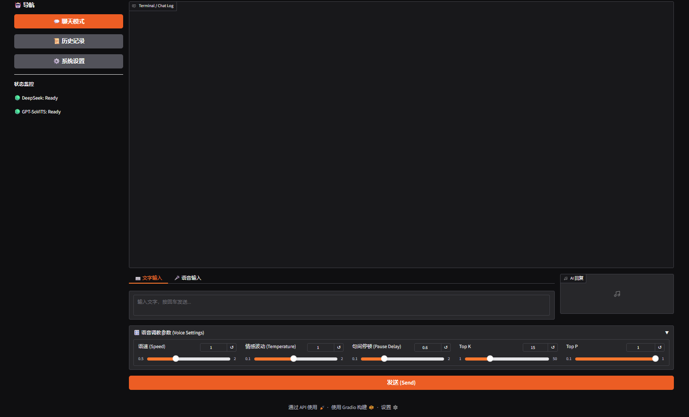

# AI Voice Chat WebUI (for GPT-SoVITS)

基于 GPT-SoVITS、DeepSeek API 和 Gradio 的语音聊天学习项目。支持文字或麦克风输入，由 DeepSeek 生成回复，再使用 GPT-SoVITS 合成语音。默认参考音频和回复语言为日语。



## 模型下载

**Git 仓库只提供代码和配置样例，训练模型通过 [GitHub Release v1.0-models](https://github.com/xiaoye-learner/ai_bot/releases/tag/v1.0-models) 单独下载。** 克隆仓库不会自动下载模型。

| 模型文件 | 用途 | 大小 |
| --- | --- | --- |
| `BlueArchive_meidai_e15_s660.pth` | 美代 SoVITS 声学模型（v2Pro） | 134,946,419 字节 |
| `BlueArchive_meidai-e25.ckpt` | 美代 GPT 语义模型 | 155,313,376 字节 |

两个文件均放在 `GPT_SoVITS/pretrained_models/`。Release 附带 `SHA256SUMS.txt`，完整下载清单见 [docs/models.json](docs/models.json)。推理还需要 HuBERT、RoBERTa 和 v2Pro 说话人编码器，它们从上游 Hugging Face 下载，不重复上传到本仓库的 Release。准备脚本固定上游版本并校验文件，无需下载所有版本的 GPT/SoVITS 底模。

## 快速开始（Docker）

### 1. 环境准备

- NVIDIA 显卡、驱动，以及支持 GPU 的 Docker / Docker Compose；Windows 可使用 Docker Desktop 的 WSL2 后端。
- 宿主机 Python 3.9 或更高版本；模型准备脚本仅使用标准库。
- DeepSeek API Key，以及模型和 Docker 镜像的下载空间。

原测试显卡为 RTX 5060，部署沿用 `xxxxrt666/gpt-sovits:latest-cu128`。此镜像标签可能变化，实际兼容性取决于驱动、镜像和依赖版本。

### 2. 克隆并准备模型

```bash
git clone https://github.com/xiaoye-learner/ai_bot.git
cd ai_bot
python tools/prepare_models.py --with-base
```

脚本下载两个角色模型及所需上游模型，校验文件大小和 SHA-256，并从样例生成 `GPT_SoVITS/configs/tts_infer.yaml`。已有模型通过校验后跳过；已有配置保留。现存模型与清单不同时，脚本会报错并保留原文件，请确认后移走该文件再重新下载。

若已有完整底模，只需运行 `python tools/prepare_models.py`。无法访问 Hugging Face 时，可以为上游模型指定兼容镜像：

```bash
python tools/prepare_models.py --with-base --hf-endpoint https://hf-mirror.com
```

该参数仅影响上游模型，角色模型仍从 GitHub Release 下载。手动准备方式见 [模型说明](docs/models.md)。

### 3. 配置 API Key

复制 `.env.example` 为 `.env`，填入自己的 Key：

```dotenv
DEEPSEEK_API_KEY=你的DeepSeek_API_Key
```

Docker Compose 会把它传给 WebUI。`.env` 被 Git 忽略，请勿提交真实 Key。本地直接启动 Python 客户端时，需要另行设置同名环境变量，程序不会自动读取 `.env`。

参考音频与语言在 `webui.py` 中配置：`REF_AUDIO_PATH` 默认是 `asset/09_大厅5.mp3`，路径由 TTS 服务端读取；`REF_TEXT` / `REF_LANG` 对应参考文本和语言；`TARGET_LANG` 是合成语言，默认为日语。

### 4. 检查并启动

```bash
python tools/prepare_models.py --check
docker compose config --quiet
docker compose up -d --build
```

- WebUI：http://localhost:7860
- TTS API：http://localhost:9880
- 查看日志：`docker compose logs -f gpt-sovits-bot webui`
- 停止服务：`docker compose down`

Compose 将当前项目目录挂载到容器中，必须先准备本地模型和配置。首次启动可能另外下载语言处理资源，首次麦克风识别会下载并加载 Whisper `large-v3`。启动后可先使用文字输入检查聊天和语音合成。

## 项目结构

```text
.
├─ webui.py                         # Gradio 聊天界面
├─ client_bot.py                    # 本地命令行语音客户端
├─ api_v2.py                        # GPT-SoVITS 推理 API
├─ docker-compose.yaml              # TTS + WebUI 服务
├─ Dockerfile.webui                 # WebUI 镜像
├─ .env.example                     # API Key 环境变量样例
├─ tools/prepare_models.py           # 下载、校验模型并准备推理配置
├─ docs/models.json                 # 模型版本、大小及 SHA-256
├─ docs/models.md                   # 模型来源与手动准备说明
├─ GPT_SoVITS/configs/
│  ├─ tts_infer.example.yaml         # 可提交的推理配置样例
│  └─ tts_infer.yaml                 # 本地运行配置，脚本生成，Git 忽略
├─ GPT_SoVITS/pretrained_models/     # 本地模型，Git 忽略
└─ asset/                           # 参考音频和文本
```

## 界面与项目范围

聊天页面支持文字、麦克风输入，以及语速、Temperature、Top-K / Top-P 和句间停顿调整。历史记录页面和系统设置保存目前为占位功能，实际配置以代码、环境变量和推理配置文件为准。

这是学习 Docker 与 TTS 的项目，尚未提供生产部署和完整依赖锁定。训练、其他版本底模和更多语言用法请参考 GPT-SoVITS 原项目。

## 参考来源与授权

- [GPT-SoVITS](https://github.com/RVC-Boss/GPT-SoVITS)
- [GPT-SoVITS 上游模型](https://huggingface.co/lj1995/GPT-SoVITS)
- [DeepSeek API](https://platform.deepseek.com/)
- [Gradio](https://www.gradio.app/)
- [原项目使用的角色音频来源](https://www.gamekee.com/ba/tj/674785.html)

代码授权见 [LICENSE](LICENSE)。模型、参考音频与依赖项分别遵循其原始来源的权利和授权；代码许可证不替代这些资源的授权。
